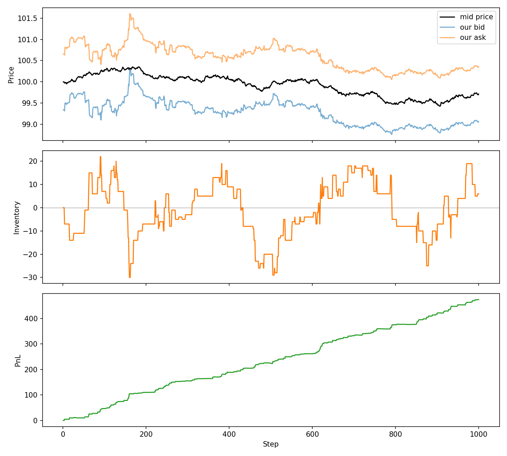

# Market Maker Simulator

A simple Python simulation of a market maker. It shows how a market maker
decides what prices to quote for buying and selling, while managing the
risk of holding too much stock.

It is based on the Avellaneda-Stoikov model.

## What it does

1. The stock price moves randomly at each step.
2. The market maker quotes a **bid** (price it will buy at) and an **ask** (price it will sell at).
3. Random client orders arrive. Orders are more likely when our prices are close to the market price.
4. When an order fills, our cash and stock holding (inventory) are updated.
5. If we hold too much stock, the model lowers our prices to encourage selling.
   If we hold too little, it raises them. This keeps our inventory under control.
6. Profit (PnL) is calculated as cash + the current value of the stock we hold.

## How to run it

1. Install Python and the plotting library:
   ```
   pip install matplotlib
   ```
2. Run the file:
   ```
   python market_maker.py
   ```

It prints a short summary and saves a picture called `simulation_results.png`.

## Result



- **Top:** the stock price with our bid and ask prices
- **Middle:** our inventory over time
- **Bottom:** our profit over time

## Files

- `market_maker.py` - the simulation code
- `simulation_results.png` - the output graph
- `requirements.txt` - the library needed to run it

## Note

The results use a fixed random seed, so you get the same graph every time.
Remove the `rd.seed(42)` line in the code to get a different one each run.
